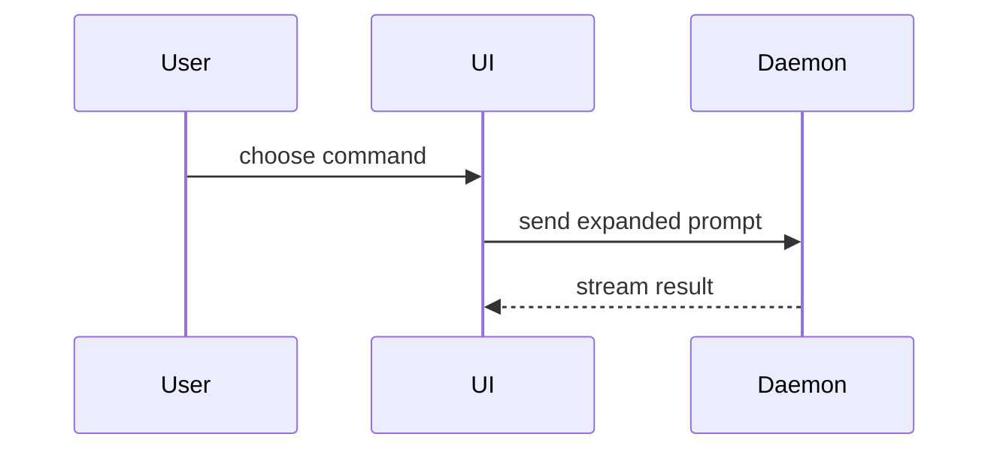

# PR

寫 PR body 時，用這個範本。

```markdown
## Summary

<diagram, diff-sketch, or tree>

## Evidence

- **Before:** <screenshot/output/failing test run>
  **After:** <screenshot/output/passing test run>

## Merge Danger

**Door:** <one-way or two-way>

<optional: description>

**Blast Radius:** <one-word description>

<optional: potential ramifications of merge>
```

## 各段說明

跳過開場白。文字要短。用專案自己的詞彙。專案有 `GLOSSARY.md` 或 `CONTEXT.md` 就讀它。

### Summary

挑最小的視角，讓重點一眼看懂。

用虛擬碼（pseudocode）呈現邏輯或演算法：

```text
on(save)
  if content is unchanged
    return cached result
  write new content
  return fresh result
```

用呼叫樹（call tree）呈現執行流程：

```text
submitForm
  createSession
    persistPrompt
    launchAgent
  navigateToSession
```

用元件樹（component tree）呈現 UI 結構，標上有關的 state 與模組邊界：

```text
<SessionPage> (apps/example/src/routes/session.tsx)
  useSessionEvents()
  <SessionToolbar>
    <RunSkillButton> (packages/ui)
```

用淺層檔案樹呈現檔案職責或大重構：

```text
src/
├── commands/       # parses user actions
├── sessions/       # owns session state
└── transport/      # sends API requests
```

用 Mermaid 呈現元件互動、控制流程或資料流：



重點是「改了什麼」，而且周圍形狀已經存在時，用 `diff`。diff 的形狀要對上主題。

元件改動：

```diff
 <SessionPage>
   useSessionEvents()
   <SessionToolbar>
+    <RunSkillButton />
   <SessionTimeline>
+    <SkillResultCard />
```

檔案配置改動：

```diff
 src/
 ├── commands/
+│   └── show-me.ts       # expands the slash command
 ├── sessions/
-└── transport.ts
+└── transport/
+    ├── client.ts
+    └── stream.ts
```

呼叫樹或呼叫堆疊改動：

```diff
 submitForm
   createSession
     persistPrompt
+    expandSkillMention
     launchAgent
-  navigateToSession
+  navigateToSession
+    subscribeToEvents
```

狀態或控制流程改動：

```diff
 on(save)
-  write content
+  if content is unchanged
+    return cached result
+  write new content
+  invalidate cache
```

整段幾乎都是新的、省略上下文會藏掉歸屬或順序、或讀者需要可複製的目標形狀時，貼完整區塊：

```ts
function expandSkill(command: string): string {
  const skillName = command.slice(1);
  return `use the ${skillName} skill`;
}
```

#### 使用要點

每張圖放在它支撐的那段短文字旁邊。只留回答目前問題所需的呼叫、檔案、props、state 與邊界。

上面這些可以只用一種，也可以用幾種。很少會全部用到。自己判斷，不要淹沒讀者。

### Evidence

拿出具體證據，證明改動可用。要有 before 與 after。

截圖是 S 級證據。改動是視覺的、環境也跑得起來時就用截圖。

執行型證據是 A 級證據。測試結果、console 輸出。用虛擬碼指出「哪個測試原本失敗、現在通過」。

### Merge Danger

說明這是一道單向門還是雙向門。雙向門走得回來，單向門走不回來。容易回滾的 PR 風險較低。含破壞性操作或難以逆轉的決定，就是單向門。

Blast radius 是這個 PR 可能造成的影響範圍。所有可能都要想。例子：layout shift、破壞下游使用者、手機版跑版。

## 本機調整

- 輸出語言：繁體中文。技術名詞可保留英文。違反時以本專案 `AGENTS.md` 為準。
- 證據不可造假。沒有截圖就寫「未截圖」。沒有跑測試就寫「未執行」。不要寫「應該沒問題」。
- 只有 GitHub。用 `gh pr view --json body` 讀現有 body，用 `gh pr edit --body-file` 更新。沒有 PR 時先產出檔案，不要自己開 PR。
- 出處：Matt Pocock `skills/engineering/pr`。Summary 的視覺化選單取自 Dex Horthy 的 `show-me`（Humanlayer）。本機已有 `show-me` skill，內容與此處重複，保留是為了讓本 skill 能單獨使用。
